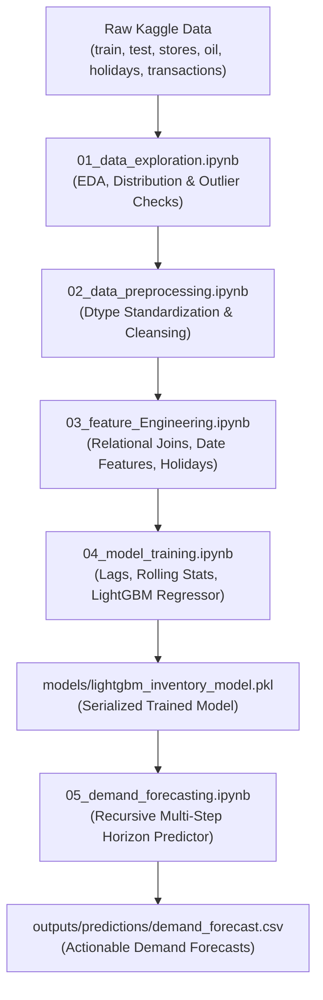

# 🏪 Store Sales & Demand Forecasting

[](https://www.python.org/downloads/)
[](https://lightgbm.readthedocs.io/)
[](https://opensource.org/licenses/MIT)
[](https://github.com/psf/black)

An end-to-end Machine Learning and Time Series forecasting pipeline designed to accurately forecast unit sales for thousands of items across 54 grocery stores in Ecuador (**Corporación Favorita**). 

The system leverages gradient-boosted decision trees (**LightGBM**), sophisticated temporal lag & rolling window feature engineering, external macroeconomic signals (crude oil prices), store metadata, and holiday calendars to significantly outperform traditional baseline forecasting models.

---

## 📌 Table of Contents
- [Business Problem](#-business-problem)
- [Architecture & Pipeline](#-architecture--pipeline)
- [Key Results & Benchmarks](#-key-results--benchmarks)
- [Repository Structure](#-repository-structure)
- [Notebook Workflow](#-notebook-workflow)
- [Feature Engineering Highlights](#-feature-engineering-highlights)
- [Installation & Quickstart](#-installation--quickstart)
- [Dataset Download Guide](#-dataset-download-guide)
- [Recursive Forecasting Engine](#-recursive-forecasting-engine)
- [Tech Stack](#-tech-stack)
- [License](#-license)

---

## 🎯 Business Problem

Retail grocery inventory management requires striking a delicate balance:
* **Overstocking** ties up working capital, increases holding costs, and leads to perishable food spoilage.
* **Understocking** results in lost revenue, frustrated customers, and damaged brand reputation.

This project delivers a multi-step forward demand forecasting solution capable of generating store- and family-level sales predictions. By capturing seasonal cycles, promotional lifts, local holidays, and macroeconomic oil shocks, the model equips inventory managers with data-driven replenishment signals.

---

## 🏗 Architecture & Pipeline



---

## 📊 Key Results & Benchmarks

The model was evaluated on a 14-day temporal holdout validation set:

| Model Architecture | MAE (Mean Absolute Error) | RMSE (Root Mean Squared Error) | RMSLE | Error Reduction vs. Baseline |
| :--- | :---: | :---: | :---: | :---: |
| **Naive Baseline (Lag-7 Persistence)** | 101.25 | 353.80 | — | *Benchmark* |
| **LightGBM Regressor (1000 estimators, early stopping)** | **78.36** | **226.90** | **1.58** | **-22.6% MAE / -35.9% RMSE** |

### Top 10 Influential Features:
1. `rolling_mean_7` (7-day historical rolling average)
2. `day` (Day of month)
3. `lag_7` (Sales from exactly 7 days prior)
4. `lag_14` (Sales from 14 days prior)
5. `year_name` & `week_name` (Temporal cycle indicators)
6. `lag_28` (4-week monthly seasonal lag)
7. `onpromotion` (Count of promotional items)
8. `family` (Product family / category)
9. `week_of_year` (Annual seasonality)
10. `is_national_holiday` (National holiday indicator)

---

## 📂 Repository Structure

```text
Store Prediction/
├── .github/
│   └── workflows/
│       └── ci.yml               # GitHub Actions CI for dependency and notebook validation
├── data/
│   ├── raw/                     # Original Kaggle data (gitignored, see data/README.md)
│   │   └── .gitkeep
│   ├── processed/               # Feature-engineered matrices (gitignored)
│   │   └── .gitkeep
│   └── README.md                # Data documentation and download instructions
├── models/
│   ├── lightgbm_inventory_model.pkl # Trained LightGBM model weights (~183 KB)
│   └── .gitkeep
├── notebooks/
│   ├── 01_data_exploration.ipynb     # Exploratory Data Analysis & visual insights
│   ├── 02_data_preprocessing.ipynb   # Data type casting & cleansing
│   ├── 03_feature_Engineering.ipynb  # Relational merges & temporal features
│   ├── 04_model_training.ipynb       # Model training, validation & benchmarking
│   └── 05_demand_forecasting.ipynb   # Recursive multi-step forward inference
├── outputs/
│   └── predictions/
│       ├── demand_forecast.csv       # Final generated demand predictions
│       └── .gitkeep
├── .gitignore                   # Comprehensive ignore rules (ignores >100MB files & venv)
├── LICENSE                      # MIT License
├── README.md                    # Project documentation
└── requirements.txt             # Python dependencies
```

---

## 📓 Notebook Workflow

1. **`01_data_exploration.ipynb`**:
   - Inspects target distribution, summary statistics, skewness, and missing records.
   - Plots daily aggregate sales patterns, seasonality across weeks, and family-wise revenue contribution.
   - Explores relationship between promotional intensity (`onpromotion`) and store sales.

2. **`02_data_preprocessing.ipynb`**:
   - Converts dates to standard `datetime64` representations.
   - Casts store identifiers (`store_nbr`) and sales targets to memory-efficient numeric representations.
   - Validates data completeness and guarantees zero corrupted records.

3. **`03_feature_Engineering.ipynb`**:
   - Merges complementary data: store geographic clusters, oil prices (`dcoilwtico`), national holidays, and store transactions.
   - Implements backfill/forward-fill interpolation for missing oil market dates.
   - Extracts cyclical date components: `year`, `month`, `day`, `day_of_week`, `week_of_year`, `is_weekend`.

4. **`04_model_training.ipynb`**:
   - Generates autoregressive lag features (`lag_7`, `lag_14`, `lag_28`) and rolling statistics (`rolling_mean_7`, `rolling_mean_28`) per `(store_nbr, family)` group.
   - Splitting: reserves the last 14 historical days for validation to mirror real-world testing.
   - Establishes a naive `lag_7` persistence baseline.
   - Trains `LGBMRegressor` with early stopping and evaluates performance via MAE, RMSE, and RMSLE.
   - Plots actual vs. predicted sales and extracts feature importance rankings.
   - Serializes model to `models/lightgbm_inventory_model.pkl`.

5. **`05_demand_forecasting.ipynb`**:
   - Executes multi-step forward forecasting across the test window.
   - Employs a recursive prediction architecture: dynamically recalculates lag and rolling statistics for step $t+1$ using predicted values from step $t$.
   - Exports the completed forecast matrix to `outputs/predictions/demand_forecast.csv`.

---

## ⚙️ Feature Engineering Highlights

- **Autoregressive Lags**: Captures weekly ($t-7$), bi-weekly ($t-14$), and monthly ($t-28$) recurrence patterns.
- **Rolling Windows**: Computes short-term (7-day) and medium-term (28-day) moving averages with shift-guards to prevent lookahead data leakage.
- **Macroeconomic Covariates**: Daily West Texas Intermediate (WTI) crude oil price, reflecting Ecuador's economic vulnerability and purchasing power.
- **Event & Holiday Signals**: Binary indicators for national holidays (`locale == 'National'`), preventing sales underprediction during peak holiday buying periods.
- **Promotional Lift**: Direct modeling of promotional items on store shelves.

---

## 🚀 Installation & Quickstart

### 1. Clone the Repository
```bash
git clone https://github.com/<your-username>/Store-Prediction.git
cd Store-Prediction
```

### 2. Create and Activate a Virtual Environment
```bash
# Windows
python -m venv venv
.\venv\Scripts\activate

# Linux / macOS
python3 -m venv venv
source venv/bin/activate
```

### 3. Install Dependencies
```bash
pip install --upgrade pip
pip install -r requirements.txt
```

### 4. Launch Jupyter
```bash
jupyter lab
```

---

## 📥 Dataset Download Guide

The dataset comes from the **Kaggle Store Sales - Time Series Forecasting** challenge.

1. Install the Kaggle CLI:
   ```bash
   pip install kaggle
   ```
2. Download competition files:
   ```bash
   kaggle competitions download -c store-sales-time-series-forecasting
   ```
3. Extract the contents into `data/raw/`. 

*Refer to [data/README.md](data/README.md) for full details on file schemas.*

---

## 🔮 Recursive Forecasting Engine

Because future actual sales are unknown beyond day $T$, multi-day forecasting requires a **recursive rolling strategy**:

$$\hat{y}_{t+1} = f\left(\text{lag}_7(\hat{y}), \text{rolling}_7(\hat{y}), \dots\right)$$

In `05_demand_forecasting.ipynb`:
1. The model initializes with the historical sales buffer.
2. For each day in the test period, current features are assembled from history + recent predictions.
3. Predictions are inferred using `lightgbm_inventory_model.pkl`.
4. The history buffer is updated with the new predictions to supply lag features for subsequent days.

---

## 🛠 Tech Stack

- **Language**: Python 3.10+
- **Machine Learning**: LightGBM, Scikit-learn
- **Time Series & Data Manipulation**: Pandas, NumPy, Scipy
- **Visualization**: Matplotlib, Seaborn
- **Serialization**: Joblib
- **Environment**: JupyterLab, Git, GitHub Actions

---

## 📄 License

This project is licensed under the [MIT License](LICENSE) - see the LICENSE file for details.
